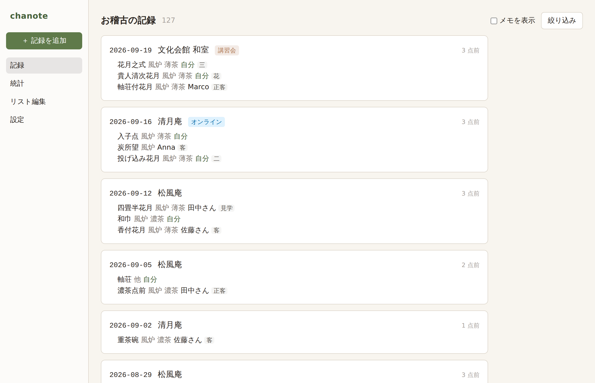
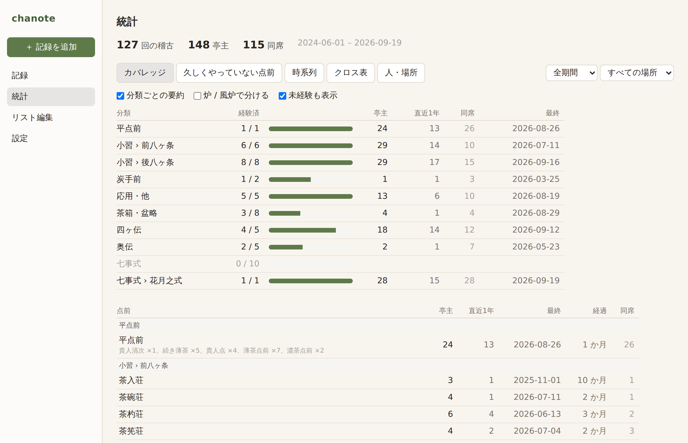
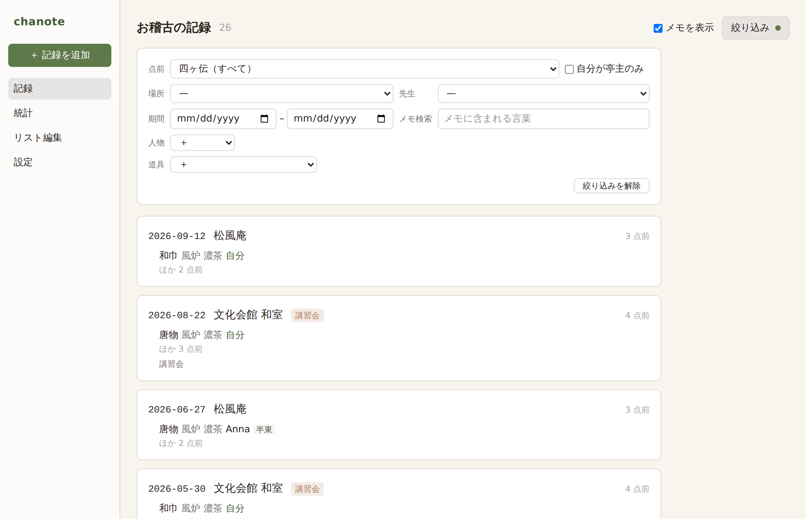
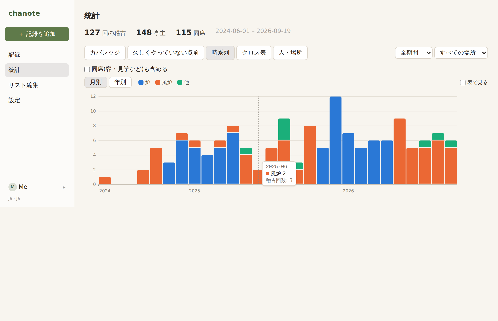

# chanote

**茶道のお稽古日記アプリ。**
English version: [README.md](README.md)

毎週お稽古に通う。点前をし、人の点前を見て、客に入り、先生に直される。数か月たつと、
炉で唐物をしたのはいつが最後だったか、そのとき棚は何だったか、正客は誰だったか、思い出せない。
chanote はその日記を代わりに付け、あとから振り返れる形にします。

  
  

## できること

**稽古帳と同じ書き方で記録。** 1日1件。日付・場所・先生と、点前ごとに1行 ── 点前、亭主、
そして自分が何をしたか(亭主・正客・客・半東・見学)。覚えている分だけ足せます:
炉/風炉、棚、濃茶/薄茶、勝手、部屋、席順、道具、メモ、写真。日付は「2019年3月ごろ」でも、
棚は「あったが種類は忘れた」でもかまいません。

**自分の呼び名で。** 「長板濃茶」「旅箪笥で薄茶」── ふだん使っている呼び名を登録すると、
chanote は元の点前と設定に展開して記録するので、統計はきちんと合算されます。

**あとから探せる。** 点前(四ヶ伝なら四ヶ伝ぜんぶ、のように分類ごとにも)、期間、場所、先生、
同席した人、使った道具、メモの言葉で絞り込めます。メモの表示をオンにすれば、次の稽古の前に
先生から言われたことをさっと読み返せます。

**知りたいことに答える統計。**
- *カバレッジ* ── 流派の全点前について回数と最終日。小習・四ヶ伝・奥伝などの分類ごとに達成バー。
- *久しくやっていない点前* ── 次に先生に願うものを、今の季節(炉/風炉)に絞って。
- *時系列* ── 月ごとの稽古量を炉・風炉で色分け。
- *クロス表* ── 点前×棚、点前×炉風炉、場所×先生、なんでも×なんでも。
- *人・場所* ── 先生別、場所別、見た亭主別、同席者別。

  
  

**道具に記憶を。** 分類(茶碗・薄器・濃茶器・仕覆・茶杓・水指・水次)、伝来や箱書の自由メモ、
そして組 ── 茶入を選べば仕覆もついてきます。

**あなたのものは、あなたの手元に。** データは1つの SQLite ファイルと写真フォルダとして
パソコンの中にあります。アカウント不要、サーバー不要、収集なし。JSON(完全)や
CSV(1行=1点前、Excel や pandas 向け)に書き出し、写真込みの zip バックアップを別の Mac に復元。
1台を複数人で使うときは、人ごとに別の日記を持てます。稽古仲間の書き出しを「自分の日記として」
読み込むこともでき、相手の記録での客としての登場が自分の役割になります。

**日本語と英語。** 画面は両言語。茶道用語は日本語のみ・日本語+ローマ字・ローマ字のみを選べ、
ホバーで英語の説明が出ます。

## 流派について

内蔵の点前一覧は **裏千家** のものです(平点前、小習十六ヶ条、炭手前、茶箱、四ヶ伝、奥伝、
七事式 …)。これはプログラムではなくデータなので、他流派の方も「リスト編集」で点前を改名・
非表示・追加すれば、今すぐ十分に使える日記になります。

表千家・武者小路千家・江戸千家・遠州流などの本格対応は **流派パック** として予定しています。
流派ごとに1つの YAML ファイルで、点前・棚・既定値を記述するものです。作者は裏千家で、
他流派を正しく書けるほどには知りません。ご存じの方の **ご協力を歓迎します** ──
書き方は [docs/school-packs.md](docs/school-packs.md) を。数百行のテキストで、プログラミングは不要です。

## インストール

**[Releases](../../releases)** から最新版をダウンロードしてください。

- **macOS**: `.dmg` を開いて *chanote* を「アプリケーション」へドラッグ。Apple Silicon(M1 以降)は
  `aarch64`、Intel は `x64`。初回だけ右クリック→「開く」で起動します(Apple の署名をまだ付けて
  いないため。2回目からは普通に開けます)。「壊れているため開けません」と出たらターミナルで
  `xattr -cr /Applications/chanote.app` を一度実行してください。
- **Windows**: `.exe` インストーラを実行。
- **Linux**: `.AppImage` または `.deb`。

まずデータ入りで試したい方は、設定 → 「JSON を読み込む」で
[`samples/sample-data.json`](samples/sample-data.json)(架空の2年分)を読み込んでください。
設定 → 「使う人」で別の人を作っておくと、自分の日記と混ざりません。

## データの場所

macOS: `~/Library/Application Support/jp.chanote.app/` の `chanote.sqlite` と `attachments/`。
Windows: `%APPDATA%\jp.chanote.app\`。Linux: `~/.local/share/jp.chanote.app/`。
設定 → 「バックアップを保存」で両方を zip にし、「バックアップから復元」で戻せます。

## ソースからビルドする

[CONTRIBUTING.md](CONTRIBUTING.md) を参照。

## ライセンス

MIT ── [LICENSE](LICENSE)
